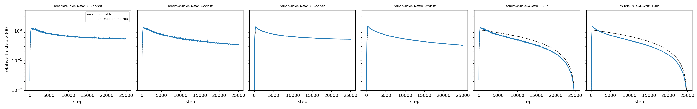

# elrstats: per-matrix effective learning rate, correct under sharding

The **effective learning rate** (ELR) of a weight matrix is its relative step:

ELR = η · ‖U‖ / ‖W‖

η is the nominal learning rate, U is the optimizer update direction, and W is the weight.
Recent posts argue that ELR, not η, is the step size that drives training
([Su Jianlin, 2026-10-27](https://kexue.fm/archives/11985);
[Jiaxuan Zou, 2026-08-25](https://jiaxuanzou0714.github.io/blog/2026/hyperball-implicit-lr-schedule/)).

This repo has two parts:

1. **`elrstats`**, a small library. It computes ‖W‖², ‖U‖² and ⟨W,U⟩ for every matrix with **one all-reduce per step**. It is correct under FSDP2, TP and FSDP2×TP. It can also split a fused matrix into logical sub-matrices (q/k/v inside a fused QKV, one expert inside a 3-D MoE weight).
2. **A measurement study.** 16 runs of GPT-124M on FineWeb-edu (AdamW and Muon, 25k steps each) that log per-matrix ELR every 25 steps.

## Main results (GPT-124M, 0.82B tokens)

Full report: [`results/final/REPORT.md`](results/final/REPORT.md). Two seeds for four configs: seed noise is ≤ 0.004 in loss and ≤ 3% on the Q1–Q3a numbers below. Per-layer numbers vary more.

- **A constant nominal lr is not a constant ELR.** Without weight decay, median ELR at 95% of training is 0.34× its value at step 2000 (AdamW and Muon). Over the same span the median ‖W‖ grows 3.6× (AdamW) / 3.0× (Muon) while ‖U‖ stays flat. With WD 0.1 the decay is about 2×.
- **At mid-training of a linear-decay run, a third to a half of the change in log ELR is implicit** (40% for AdamW, 35% for Muon at lr 6e-4; only 16–19% at 4× lr).
- **Kosson's AdamW equilibrium formula** √(2ηλ(1−β₁)/(1+β₁)) matches the measured angular update within 6%. Plain √(2ηλ) is about 4× too high.
- **4× the nominal lr gave 1.9–2.1× the ELR** in const + WD runs late in training, consistent with √η scaling at equilibrium.
- **Relative change and angle agree** within 0.2% in every run, because cos(W,U) is small (median ≤ 0.057).
- **Mixed result on fused QKV:** with WD, the whole-QKV ELR hides k mostly in layer 0; without WD, k also differs by 25–45% in the last layers.



## Library usage

```python
import torch
from elrstats import LogicalSpec, ParamEntry, StatsLayout, matrix_stats

# params may be plain tensors or DTensors (Shard, _StridedShard, Replicate).
# one label per global row of the fused weight: 0 = q, 1 = k, 2 = v
labels_per_row = torch.arange(3 * d_model) // d_model
qkv_spec = LogicalSpec(dim=0, labels=labels_per_row, names=["q", "k", "v"])
layout = StatsLayout([ParamEntry("blk0.qkv", qkv.weight, spec=qkv_spec),
                      ParamEntry("blk0.o", o.weight)])

stats = matrix_stats(layout, updates)  # one all-reduce over the world group
elr = stats.elr(lr)                    # per logical matrix, fp64
aus = stats.aus(lr)                    # angular update size, atan2-based
```

- `Partial` placements and unknown placements raise an error. Labels out of range, or a label count that does not match the global size, also raise.
- `matrix_stats(..., async_op=True)` returns `(work, buf)`. Call `work.wait()` (if `work` is not None), then `MatrixStats.from_buffer(buf)`.
- `group` must contain every rank of the params' meshes (default: the world group).
- Manual (Megatron-style) TP shards pass their offset and size through `ParamEntry(tp_dim=..., tp_offset=..., tp_global=..., tp_size=...)`.
- `relative_scales(stats)` gives the per-matrix scale for a relative (LAMB / Hyperball-style) update with global norms.

## Install

No package yet. Clone the repo and put it on `PYTHONPATH`. Requirements: Python ≥ 3.9 and PyTorch with `torch.distributed.tensor` and FSDP2 (`fully_shard`). Tested on torch 2.8 (CPU, gloo) and 2.13 (8×A100, NCCL). The library uses the private helper `torch.distributed.tensor._utils.compute_local_shape_and_global_offset`, so a future torch release may break the import.

## Tests

```bash
python tests/test_stats_dist.py --world 4 --backend gloo
```

```bash
python tests/test_stats_dist.py --world 8 --backend nccl
```

The tests compare against an unsharded fp64 reference. Cases: 1-D Shard(0)/Shard(1)/Replicate, real FSDP2×TP on 2-D meshes, interleaved GQA QKV, 3-D MoE expert parallel, manual TP rows, fp32 and bf16. All pass on NCCL with world 2/4/8 (errors ≤ 2e-7). Tested with torch 2.13.0+cu130 on 8×A100 PCIe.

## Reproducing the study

```bash
EXP=/path/to/exp PY=python bash study/launch.sh 25000
```

```bash
python study/analyze.py results/runs results/final
```

`launch.sh` submits through `expq`, a small task-spooler wrapper. Replace `run()` with your own job launcher, or run one config directly:

```bash
python study/train.py --opt adamw --lr 6e-4 --wd 0.1 --sched linear --steps 25000 --out runs/adamw-lr6e-4-wd0.1-lin
```

Data: FineWeb-edu 10B tokenized with GPT-2, in the modded-nanoGPT `.bin` format (see its `data/` scripts). Point `ELR_DATA` at the shard folder (files `fwedu_train_*.bin`, `fwedu_val_*.bin`). Raw run logs (`results/runs/`, ~220 MB) are attached to the [v0.1-study release](https://github.com/haosenwang1018/elrstats/releases/tag/v0.1-study); extract the archive at the repo root.

## Layout

| Path | What |
|---|---|
| `elrstats/stats.py` | The library |
| `tests/test_stats_dist.py` | Distributed correctness tests |
| `bench/bench_stats.py` | Cost benchmark (~8 min on 2 or 8 A100s; numbers in PITFALLS D1) |
| `study/` | Trainer, launcher, analysis, health watcher |
| `design/study.md` | Pre-registered experiment design and criteria |
| `DESIGN.md` | Project goals and decision log |
| `PITFALLS.md` | Every bug, incident and process mistake, with fixes |
| `results/final/` | Report, figures, `summary.json` |

## Status and limits

- 124M only, 0.82B tokens, no QK-norm, RMSNorm gains get weight decay.
- The runs were launched before the criteria in `design/study.md` were reviewed; the changes are listed in its Log.
- No cost numbers yet: the benchmark hang is open.
- The Muon equilibrium value is measured, not derived.

## Related work

- NVIDIA Emerging-Optimizers `RelativeUpdateHook` / `HyperballHook` ([PR #224](https://github.com/NVIDIA-NeMo/Emerging-Optimizers/pull/224)): the same update rule with local-tensor norms.
- LARS ([arXiv 1708.03888](https://arxiv.org/abs/1708.03888)) and LAMB ([arXiv 1904.00962](https://arxiv.org/abs/1904.00962)): layer-wise trust ratio.
- OLMo [`olmo/optim.py`](https://github.com/allenai/OLMo/blob/main/olmo/optim.py): per-parameter norms packed into one all-reduce (no logical sub-matrices, no update statistics).
- Levanter [`WatchCallback`](https://github.com/stanford-crfm/levanter/blob/main/src/levanter/callbacks/watch.py) (JAX).

## License

MIT
